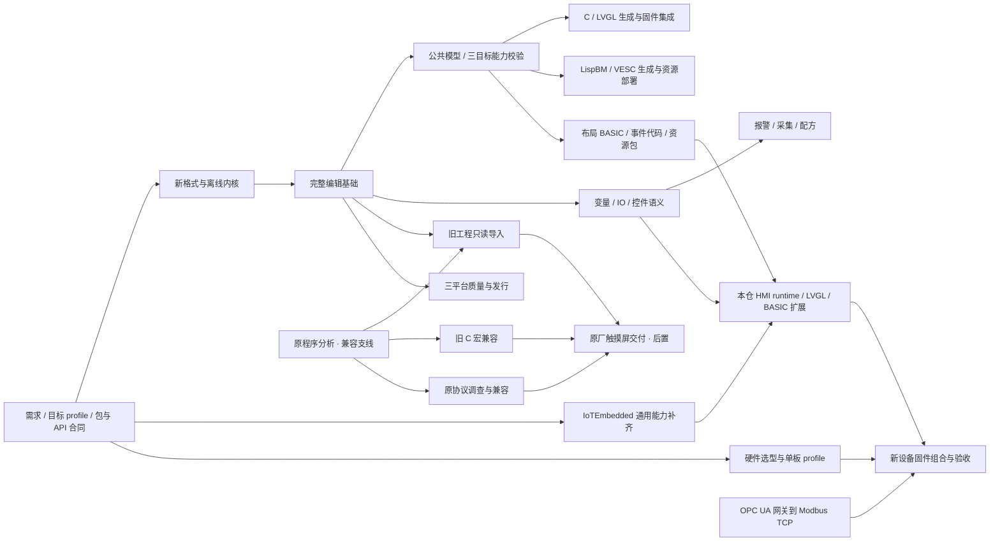

# HmiCraft · 可编程人机界面平台路线图

更新：2026-10-11。用户最新确认：**lvgl-editor 统一承担 VB6 式可视化设计，C/LVGL、LispBM/VESC、BASIC/IoTEmbedded 为三条正式输出主线**。自有工业 HMI 继续走 IoTEmbedded + LVGL；桌面先 Windows，再 Linux/macOS；旧 外部样本 工程/宏/旧屏兼容后置。当前已有桌面切片和固定 Web 子模块；本批开始修订合并 PR #3、统一目标选择和基础 BASIC 生成/包合同，设备运行链路仍待实现验收。

中文名“可编程人机界面平台”、英文名 **HmiCraft**、GitHub **IoTSharp/HmiCraft**已由用户确认并授权创建/推送，最新决定为**保持公开**。知识入口见 [项目知识库](docs/knowledge/README.md)。用户随后提出以 `IoTSharp/lvgl-editor` 发展在线版并整合两个 PR：现阶段采用固定 main 子模块先接入，在线优先/共用 Web UI 的后续方案见 LVE；原 C# 内核和离线切片保留，不能把旧路线中的 Avalonia 选择当作排斥 Web 的约束。

状态含义：`done-local`=本机对应证据通过；`done-doc`=分析/方案已落文档，不代表实现或设备验收；`partial`=已覆盖一部分且明确缺口；`planned`=尚未实现。下列 ID 是本地交付编号，不是远端 issue。每个任务标明主归属，跨仓改动分别验收。

## 本次确认的需求与项目分工

1. 拖放控件、属性和事件编辑采用 VB6 式工作流，可视化统一在 `external/LvglEditor` 演进。公共模型分别输出 C、LispBM/VESC 和 BASIC/IoTEmbedded；BASIC 目标把**布局也生成 BASIC**，调用固件中的 LVGL 控件库。生成代码与各目标用户代码分开保存，切换目标与重生成不能丢失用户逻辑。
2. 基础固件内置框架/驱动、LVGL 和控件/脚本扩展库；日常下发独立资源与脚本包，支持动画、字体/图片和 BASIC。新增原生能力才需升级固件。
3. LvglEditor 负责可视化、公共模型、初始化目标配置、三种代码生成和资源打包；本仓初始化时指定目标/profile、适配工程并消费产物，负责 HMI 控件/API、包加载、事件/变量绑定、部署与设备集成。IoTEmbedded 负责通用 MCU/RTOS/BSP、显示/输入驱动、GPIO/ADC/PWM/总线/协议、BASIC 内核和存储。
4. 首款研究工业 HMI：4.3～7 寸、24V、触摸、RS485；GPIO/温度/位置计数/开关/模拟量等状态采集，Modbus/TCP/串口扩展。高速计数由硬件承担，不由 BASIC 做轴运动闭环。
5. BASIC 需要持续事件循环，处理定时器/变量变化/界面/外设，执行受预算限制且不阻塞 UI。
6. OPC UA 首版由网关转换为 Modbus/TCP；不把 native OPC UA 加入 MCU 首版要求。
7. 硬件未指定，用户要求联网选型。当前建议 P4 + 外部内存 + 工业 IO 板，STM32H7 备选；准确 SKU、通道数、工业等级、预算和性能仍需首板冻结与实测。
8. 同时服务开发者/小团队及设备厂商，自售设备、支持第三方 OEM、提供定制服务；公共平台、独立商业工具、生产资料与客户专属成果分开，见 GOV/BIZ。

详细合同：[设备层架构和职责](docs/design/embedded-runtime.md)。源码依据：[IoTEmbedded 基线](docs/analysis/iotembedded-baseline.md)。候选与成本：[硬件选型](docs/design/hardware-selection.md)。

## 阶段与依赖

先稳定公共编辑器和目标合同，再按 OUT 路线分别推进三种输出；BASIC 自有设备路径实现“设计器生成 BASIC/资源 → 包下载 → 新设备 LVGL/事件/IO”的最小闭环。三目标分别验收，不要求同批完成。R0/R5/R6/R7/R8 为后置兼容支线；R9 随稳定切片做跨平台验证。

## GOV：名称、知识、仓库和发行治理

| ID | 主归属 | 交付 | 状态 | 验收/依赖 |
|---|---|---|---|---|
| GOV-01 | 产品/架构 | 项目知识库与决策登记 | done-doc | 用户确认、规划基线、源码事实和未定项分开；与路线/交接相互链接 |
| GOV-02 | 产品 | HmiCraft 英文名与中文名、产品族 | done-doc | 用户已选择 HmiCraft；中文名不变，品牌不加 IoTSharp 前缀；组织归属另列 |
| GOV-03 | 仓库维护 | IoTSharp/HmiCraft 仓库及初始推送 | done-local | 已创建并推送main，GitHub回读一致、两子模块SHA可获取；最初private，用户最新明确保持public；历史清理见GOV-08 |
| GOV-04 | 发布/权属 | 分目录许可、第三方清单和贡献政策 | planned | MIT/MPL-2.0 方案按文件定稿；模板/生成输出/商业扩展明确；LvglEditor 缺许可文件问题闭合；GOV-05、LVE-02 |
| GOV-05 | 产品/架构 | 开源、商业、客户与生产资料边界 | done-doc | 社区能完成基础闭环；Pro 卖效率；客户定制/私钥/生产资料独立管理，见知识库 |
| GOV-06 | 发布/验证 | 社区源码公开与正式发行检查 | partial | 用户确认源码仓库公开，匿名内容检查完成；权属/许可、源码制品、兼容矩阵及恢复仍待完成；不等于正式开源许可发行或设备交付；GOV-03/04、INT-03 |
| GOV-07 | 各端维护者 | 品牌与技术标识迁移 | planned | UI/文档/程序集映射明确；旧工程可读；桌面改动执行 GUI smoke，Web 改动执行浏览器旅程；GOV-02、LVE-04 |
| GOV-08 | 研究/仓库维护 | 匿名研究表达、外部本地资料与历史清理 | done-local | 已匿名化并移出必要资料，脚本参数化；原根提交重写、带明确lease强推并回读；可达历史零命中，旧本地提交对象已清理；见匿名化验证 |
| GOV-09 | 产品/研究 | 多类商业与开源方案统一任务集比较 | planned | 六控件/变量/事件/资源/保存/预览/交付/恢复；资料、源码、运行、硬件证据分开；输出本项目选择和验收，不披露竞品身份 |

## LVE：在线编辑器接入与 PR 选择

依据：[固定源码及两个 PR 的整合分析](docs/analysis/lvgl-editor-integration.md)。本仓先用 `external/LvglEditor` 固定上游 main；不会把对上游 PR 的静态复核写成已合并或所有功能通过。

| ID | 主归属 | 交付 | 状态 | 验收/依赖 |
|---|---|---|---|---|
| LVE-01 | HmiCraft 集成 | LvglEditor 固定子模块与事实基线 | done-local | main=`0d0d62f655442dd5624a00390b7652222a7b3fc8`；与 IoTEmbedded 分开；保留上游源码 |
| LVE-02 | 维护者/发布 | 上游源码/资源/WASM 许可与来源 | planned | README MIT 声明、缺少 LICENSE、字体/图标/WASM 来源分别核查；不擅自重授权 |
| LVE-03 | 编辑器维护 | PR #2/#3 选择性采纳 | partial | PR #3已修订并正式合并，merge=`9e458f8b7b7eda8898c4633535b68f73679af02e`，保留C并加入BASIC；GEN-11为done-remote，首次Pages CI失败已补修d325fce，Node20.20.2 run38077281534源码测试/构建/Pages部署成功；#2 为桌面草稿且 macOS 未支持，独立推进 |
| LVE-04 | 产品/前端/.NET | 在线主入口与离线/桌面共用 UI 方案 | planned | 先静态 Web 本地工程，再离线缓存/恢复；Web 编辑保存/导出、可重复部署；桌面/本地桥解决明确设备访问缺口；复用同一画布，保留 C# 核心合同；LVE-01/08 |
| LVE-05 | HmiCraft 宿主集成 | 初始化 LvglEditor 目标配置并消费输出 | planned | 按子仓 GEN-01/02/10 配置目标/允许范围/profile，导入旧工程、获取产物/诊断；不在父仓重复实现生成；OUT-01、E0-04、LVE-04 |
| LVE-06 | runtime/验证 | Web LVGL 预览与设备语义一致性 | planned | Canvas、预编译 WASM、同一 BASIC/runtime 预览分别证明；资源/事件轨迹与固定包；HMI-05/06/09、LVE-05 |
| LVE-07 | 交付/验证 | 在线版设备下载和可选本地桥 | planned | 浏览器能力探测、允许来源/用户选择设备、长度与取消；不把开发编译服务直接公开；HMI-08、LVE-04/05 |
| LVE-08 | 编辑器维护/验证 | 固定 Web 基线修复与完整门禁 | partial | 保留2026-10-10 tsc退出2、Vitest386通过/4失败、静态bundle退出0；2026-10-11类型/字体回归修复，实际build退出0、509通过/48C编译跳过、小样例三目标ZIP/JSON和三语切换/BASIC恢复通过；Node20.20.2 CI源码测试/构建/Pages部署已通过，完整资源/旅程及目标编译仍待验，不用打包替代类型检查；LVE-01 |
| LVE-09 | 编辑器维护 | PR #3 通用能力分项采纳 | partial | 已采纳已审查 LispBM/i18n 来源及三目标接线，保留 main C 代码/测试；本地509通过/48 C编译跳过、类型/打包通过；其他画布/状态/资源通用大改暂不采纳，小样例三语浏览器已通过；远端合并回执已核实，首轮Pages CI失败已补修d325fce，Node20.20.2 run38077281534源码测试/构建/Pages部署成功；完整能力/设备另验；LVE-03/08、GEN-11/12 |
| LVE-10 | 桌面/本地集成 | PR #2 菜单与宿主分项采纳 | planned | 菜单可先复用，OmniHost 单独验证包源/资源路径/.NET版本/本地权限；macOS 缺口独立关闭，workflow 跳过不能算包通过；LVE-03/04/08 |
| LVE-11 | LvglEditor 文档/UI | 子仓三语门面、双语路线和 UI 国际化 | partial | 映射 GEN-12；README 英/中/俄、ROADMAP 英/中同步，子仓 AGENTS 明确约束；UI 默认英文可切中俄，界面覆盖独立验证；父仓保持中文；D37 |

在线 MVP 顺序：LVE-08 质量基线 → LVE-04 浏览器本地工程 → LVE-05/OUT-01 公共模型与目标合同 → OUT-02/03/04 分目标生成与验证。BASIC 设备路径继续 LVE-06 同运行时预览 → LVE-07 设备交付；C/VESC 的运行与部署分别归对应 OUT 任务。LVE-09 的通用修复按具体收益插入；LVE-10 桌面宿主复用同一工作台。账户、云协作和服务器编译暂不作为 MVP 前提。

## OUT：统一可视化设计与三条输出主线

用户确认来源为 D32～D37，详细职责与工程合同见 [统一设计器与三目标](docs/knowledge/designer-and-targets.md)。**可视化与三种输出全部由 LvglEditor 实现**，权威实施任务见 [子仓 GEN 路线](external/LvglEditor/ROADMAP.md)；本节只追踪子仓交付与 HmiCraft 初始化/运行集成。子仓改动独立验证/提交后，父仓才固定可获取 gitlink。

| ID | 主归属 | 交付 | 状态 | 验收/依赖 |
|---|---|---|---|---|
| OUT-01 | LvglEditor 公共 API；HmiCraft 对接 | 子仓初始化/模型/目标合同与宿主接线 | partial | 映射 GEN-01/02/10；已实现统一目标解析/生成入口、允许目标/切换限制、持久化和诊断合同，子仓本地测试/类型/打包通过；HmiCraft 实际宿主初始化、设备/API profile 会签及消费仍待 LVE-05，不把源码接口当产品接入通过；LVE-04 |
| OUT-02 | LvglEditor C 后端；目标集成 | C/LVGL 正式输出链路 | partial | 映射 GEN-03/06/13；原 C 已接统一 backend，generic/stm32cube-hal/rt-thread-scons 持久化/目录/适配合同已实现；三个profile浏览器ZIP下载通过；48项C编译环境测试跳过，固定LVGL/具体.ioc/BSP构建和板卡未验；OUT-01、LVE-08 |
| OUT-03 | LvglEditor LispBM 后端；VESC 集成 | LispBM/VESC 正式输出链路 | partial | 映射 GEN-04/06/07；已整合PR #3 LispBM源码/资源生成并接统一入口，保留C/BASIC；本地合同/编码测试通过，Lisp小样例浏览器ZIP/JSON通过，实际解释器/桥接/API/profile、脚本上传/回读及指定VESC设备未验；OUT-01、LVE-03/09 |
| OUT-04 | LvglEditor BASIC 后端；HmiCraft runtime | BASIC/IoTEmbedded 正式输出链路 | partial | 映射 GEN-05/06/07；基础绝对像素布局/事件/按目标用户模块与draft API/包/摘要/source map已实现，本地合同测试通过；包deployable=false，BASIC小样例ZIP/JSON及保存/reload恢复通过，IoTEmbedded API注册、HmiCraft runtime/资源完整转换/预算取消IO/更新恢复与板卡未验；OUT-01、E0-04、HMI-02～09、INT-03 |
| OUT-05 | HmiCraft 旧工程适配；LvglEditor 模型/代码 | 旧切片迁移与各目标用户代码保护 | planned | 宿主显式映射 .hmistudio.json 到编辑器模型；GEN-02/07 保证保存/重开/切换/重生成不丢代码；未知项诊断；OUT-01 |
| OUT-06 | LvglEditor 生成验证；各目标设备集成 | 三目标共同样例与独立证据矩阵 | partial | 映射 GEN-08/09；子仓509通过/48C编译跳过、类型/打包与C三profile ZIP浏览器通过；Lisp/BASIC小样例ZIP/JSON、三语无reload切换/BASIC恢复及九ZIP元数据检查通过，同页面资源/事件轨迹的目标运行和实板矩阵未完成，视觉/生成/编译/脚本/设备分别记录；OUT-02/03/04/05 |

## BIZ：设备、OEM 和定制业务

| ID | 主归属 | 交付 | 状态 | 验收/依赖 |
|---|---|---|---|---|
| BIZ-01 | 产品 | 双客户群与收入/交付模型 | done-doc | 开发者/小团队 + 设备厂商；自售设备、OEM、定制和 Pro 分开，见知识库 |
| BIZ-02 | 硬件/交付 | 单板单屏开发套件 | planned | 可复现示例/接线/固件/恢复/支持范围，实算成本再定价；INT-01/03/04 |
| BIZ-03 | 硬件/质量 | 标准工业 HMI 小批量 | planned | 完整 SKU/BOM、生产测试、质保、供货与恢复；不把学习套件标工业成品；INT-06、BIZ-02 |
| BIZ-04 | 合作伙伴/集成 | 第三方 OEM 三路径 | planned | 采购贴牌、自研兼容、量产设计授权分别明确；品牌认证要实测；开放 API/profile 与兼容语料；GOV-04、INT-03 |
| BIZ-05 | 定制交付 | 范围/权属/验收/维护模板 | planned | 平台既有、通用改进、客户专属、第三方组件分开；排他与买断另约；GOV-05 |
| BIZ-06 | 产品/验证 | 开发者及 OEM 小规模试点 | planned | 首次成功、重复使用、支持工时、付费意愿与成本有真实记录；数量/价格不当已获订单；BIZ-02 |
| BIZ-07 | 产品/商业工具 | Pro 首个效率功能与收费试验 | planned | 从调试/分析/批量交付选真实痛点；基础链路免费可用；不续升级不使已交付设备停机；BIZ-06、GOV-04/05 |

## E0：依赖接入、需求和共同合同

| ID | 主归属 | 交付 | 状态 | 验收/依赖 |
|---|---|---|---|---|
| E0-01 | HmiStudio 架构 | 需求决策、跨项目职责、产品主线 | done-doc | 用户已回答布局/更新/事件/工业形态/协议/实时性/优先级；未定数值明确为建议 |
| E0-02 | HmiStudio 集成 | IoTEmbedded Git 子模块 | done-local | `external/IoTEmbedded` gitlink=`e09e21ff14a7505b4c4c65e084b19293c54bb1e0`；上游源码未改；父仓随后按GOV-03完成私有推送 |
| E0-03 | 板卡集成 | 联网硬件候选、成本模型与资源测量计划 | done-doc | 厂商规格与三张价格页保留；P4 主选/H7 备选是建议，未采购/实测 |
| E0-04 | HmiStudio runtime，IoTEmbedded 会签 | 包版本、HMI BASIC API、目标能力/逻辑 IO、错误和资源归属合同 | planned | 确定编辑 schema/包/runtime/API/profile 各版本与拒绝行为；C#/C 固定向量；依赖 E0-01/02 |
| E0-05 | 板卡集成 | 单板资源预算、IO/分区/显示/依赖版本冻结 | planned | 固定屏/触控/MCU修订/引脚/内存/端序/LVGL/RTOS/编译器；资源上限先度量再冻结；依赖 E0-03/04 |

## IEB：应在 IoTEmbedded 子项目完成的通用能力

本节主归属均为 IoTEmbedded。HmiStudio 提供合同/适配测试，不能在本仓另拷贝一份通用驱动。下列均是计划，不能因上游已有相似模块而标完成。

| ID | 交付 | 状态 | 验收/依赖 |
|---|---|---|---|
| IEB-01 | 外部产品入口、模块/feature 选择、应用和任务组合钩子 | planned | 示例 F1/L4 不退化；HMI 可不带原设备业务；构建不重复编译 BSP；E0-04 |
| IEB-02 | 显示区域传输与同步/异步完成合同 | planned | RGB565/stride/旋转、缓冲寿命、DMA/缓存边界；无 HMI 对象依赖；E0-04/05 |
| IEB-03 | 触控/按键/编码器采集与事件 | planned | 坐标/校准、消抖、按下释放、计数；中断只采集；不含页面动作；E0-05 |
| IEB-04 | 具名 GPIO/ADC/PWM/UART/RS485/计数资源服务 | planned | 引脚冲突/量程/单位/时序/错误/恢复值明确；真实能力与占位能力分开；E0-05 |
| IEB-05 | Flash/文件/分区流式资源存储 | planned | 超界拒绝、故障/断电写、容量与擦写粒度；保留 EEPROM 兼容，不把 4KiB 槽当 HMI 包库；E0-05 |
| IEB-06 | BASIC 扩展注册、外部脚本加载、事件调用、让出/取消/预算 | planned | 脚本持续事件工作、超时和内存拒绝，不阻塞 UI；老启动运行接口兼容；E0-04、IEB-01/05 |
| IEB-07 | 平台/驱动能力和资源/任务健康报告 | planned | 返回准确版本、可用资源、堆/栈/执行状态；不声称源码声明就是设备可用；IEB-01 |
| IEB-08 | 最终 MCU/板卡/RTOS port | planned | 若选 P4 则新增 ESP-IDF 平台；若选 H7 则新增对应 STM32 BSP；先单目标构建/驱动样例；E0-05 |
| IEB-09 | 通用传输与提交/恢复钩子 | planned | 分块/长度/超时/取消/完整性、原子元数据、固件与数据分区分开；IEB-05/08 |
| IEB-10 | Modbus RTU/TCP 与可注册串口/TCP 驱动基础 | planned | MBAP事务/长度、字节序、RTU帧、异常/超时/重连；client 与 server 分开验收；IEB-04/08 |
| IEB-11 | 通用主机 port 与可注入时钟/存储/外设服务 | planned | Windows 首先可构建同一 BASIC 内核和所选通用模块；不链接 STM32 HAL，不用另一套解释器替代；模拟 IO 明确标识；E0-04、IEB-01/05/06 |

## HMI：当前项目的设计与设备实现

本节是跨仓交付追踪：HMI-01/02/03 的编辑/生成/打包实现归 LvglEditor GEN 任务，HmiCraft 提供并验证设备 API/包合同；HMI-04 起的自有运行时与部署仍归本仓。不能据旧任务名称在父仓另写生成器。

| ID | 主归属 | 交付 | 状态 | 验收/依赖 |
|---|---|---|---|---|
| HMI-01 | LvglEditor 工作台 | VB6 式页面/控件/属性/事件/代码工作台 | planned | GEN-02/07；R2 多画面/变量、事件入口、用户代码独立保存、诊断定位；E0-04、R2-03/04 |
| HMI-02 | LvglEditor BASIC 后端 | 工程→BASIC 布局创建与事件绑定生成器 | partial | GEN-05基础控件绝对px布局/基本样式/基础事件、独立用户模块和BASIC定位source map已实现，本地合同测试通过；hmicraft-hmi-basic/1-draft未在IoTEmbedded注册，完整能力/设备API会签、runtime与板卡后验；E0-04、HMI-01 |
| HMI-03 | LvglEditor 资源/打包；HmiCraft 合同会签 | 资源管线与独立设计包 | partial | GEN-06统一输出清单/文件摘要/代码归属与BASIC draft包已实现，deployable=false；BASIC图片/字体/动画/绑定/高级样式等不支持项阻止导出，完整资源转换/预算/version拒绝及HmiCraft runtime校验消费待实现；E0-04/05、HMI-02 |
| HMI-04 | 设备 runtime | 包加载、资源句柄、启动/卸载、对象/变量生命周期 | planned | 不执行损坏/不兼容包；限额、回收、旧代际句柄失效、错误可诊断；IEB-05、HMI-03 |
| HMI-05 | 设备 runtime | BASIC HMI API 与持续事件宿主 | planned | UI创建/属性/事件/定时器/动画/IO API固定向量；队列上限、取消、重入和预算；IEB-06、HMI-04 |
| HMI-06 | 设备 runtime | LVGL 原生控件封装与 port | planned | 一份锁定 LVGL；六基础控件先行、触摸/焦点、flush完成/线程归属；BASIC 创建真实对象；公共控件依赖 HMI-05，主机适配依赖 IEB-11，板卡适配另依赖 IEB-02/03/08 |
| HMI-07 | 设备 runtime | 逻辑 IO、变量与协议绑定 | planned | GPIO/温度/计数/ADC/PWM、点动收束、期望/接受/完成/实际反馈、质量状态；IEB-04/10、R1-05、HMI-05 |
| HMI-08 | 部署工具 + runtime | 设计包更新、能力协商、激活/回滚 | planned | 只更新资源/脚本，基础固件 SHA 不变；断包/损坏/版本冲突/启动失败可恢复；IEB-09、HMI-04/07 |
| HMI-09 | 模拟器/验证 | 同一 C runtime + LVGL 的主机预览 | planned | 相同生成 BASIC/资源的布局、事件和变量轨迹；HMI 拥有主机显示/输入适配，通用主机依赖归 IEB-11；保留 C# 编辑模拟但不冒充设备一致性；HMI-03/05/06、IEB-11 |
| HMI-10 | 网关集成 | OPC UA→Modbus/TCP 映射 | planned | 固定节点/类型/寄存器/质量/时间戳；断线过期、反向写确认；优先现成网关，无则独立 .NET 服务；IEB-10、HMI-07 |
| HMI-11 | HMI runtime | 设备端报警/历史/配方/权限等 | planned | 与桌面共同语义语料、按profile裁剪，不复制两套不一致规则；R4、HMI-05/07 |

## INT：单目标设备组合和验收

| ID | 主归属 | 交付 | 状态 | 验收/依赖 |
|---|---|---|---|---|
| INT-01 | 板卡集成 | 首板准确 BOM/profile 与成本复核 | planned | 屏/网口/24V/隔离/引脚/传感器范围、采购修订、工具链和预算明确；E0-05 |
| INT-02 | 固件集成 | IoTEmbedded + 本仓 runtime + LVGL 产品固件 | planned | 所有依赖 commit/version固定；源码/链接/map/资源预算可复现；先不烧录未知设备；IEB-01/08、HMI-06 |
| INT-03 | 验证 | 最小设备闭环 | planned | 设计器生成包→部署→BASIC建UI→触摸/实体输入→GPIO/一个温度源或固定传感器→指示灯/数值；重启回读同包；INT-01/02、HMI-07/08 |
| INT-04 | 验证 | 资源/脚本独立更新与恢复 | planned | 固件SHA保持、包代际一致；断电/损坏/超预算/旧API拒绝、旧包可恢复；HMI-08、INT-03 |
| INT-05 | 验证 | 并发与性能 | planned | LVGL动画+BASIC事件+Modbus采集；触控延迟、刷新率、堆栈、脚本死循环/超时恢复、网关质量；固定语料和阈值；HMI-09/10、INT-03 |
| INT-06 | 板卡集成 + 验证 | 工业样机和后续发行门禁 | planned | 24V/IO电气、隔离/ESD/EMC、温度/长稳、安装升级和操作文档分别验收；不由开发板演示推导认证；INT-04/05 |

## 新主线的执行顺序

1. PR #3已按GEN-11正式修订合并，继续GEN-12与三目标/多语剩余验收；Node20.20.2 CI与Pages部署已通过；冻结 E0-04/05：HMI BASIC API、生成/用户代码边界、能力/包合同、单板与资源预算；无需等待 REA 整程序逆向。
   同步推进 LVE-02/04/05，将 Web 编辑器接到同一 BASIC/包合同；GOV-03 先固化仓库，GOV-04 在公开发行前定稿许可。
2. IEB-01/02/05/06/08/11 和 HMI-01/02 以合同分工推进：通用扩展留子项目，设计器/三目标代码生成留 LvglEditor 子项目；主机 port 与板卡 port 分别验收。
3. HMI-03～06、HMI-09：先在主机让生成 BASIC 创建真实 LVGL 六控件并运行事件，再组合单板固件。
4. IEB-03/04/10、HMI-07/08、INT-03：输入、GPIO/传感器、Modbus、资源包下载与重启回读。
5. HMI-10、INT-04/05：网关、失败恢复和性能/容量，再据成本与实测定首款硬件。
6. 扩展 R3/R4/HMI-11；旧工程/宏/旧屏兼容在资源允许时独立推进。每个交付先固定证据类型，不能用桌面成功替代设备验收。
7. BIZ-02/06 先做套件和试点；工业整机、OEM 批量、定制模板与 Pro 按对应门禁推进，不在没有设备闭环时提前承诺供货。

## R0：建立可复核的原程序规格

| ID | 交付 | 状态 | 验收与证据 | 依赖 |
|---|---|---|---|---|
| R0-01 | 安装身份、PE 与文件清单 | done-local | 6,370 文件，主 EXE SHA-256、x86/无 CLR、导入模块；`匿名安装盘点记录`、REA artifact Evidence | 无 |
| R0-02 | 帮助功能矩阵、旅程、冲突表 | done-local | 46 功能域、10 旅程、648 页面/目录索引；`manual-analysis.md`，不能当运行验收 | R0-01 |
| R0-03 | 型号/驱动/宏静态契约 | done-local | 72 唯一型号、139 PLC 配置、34 宏声明；文件关联和异常有源行号 | R0-01 |
| R0-04 | REA 原生函数调查通路 | partial | Ghidra 已安装，小 DLL 直接分析退出 0；REA 主程序/模拟器索引超时，Windows 后端拒绝 DLL。需保存启动诊断、验证桥接和真实函数 Evidence，见 native-troubleshooting | R0-01 |
| R0-05 | 原程序最小黄金工程 | planned | 用原 UI 建 800×480 空工程与六控件工程；保存、关闭、重开、离线模拟；原文件字节/hash、步骤、截图、版本齐全 | R0-02 |
| R0-06 | `.hs/.sm/.knr/.laz` 格式关系 | planned | 至少空工程、单对象、变量绑定、图片、两画面五组差分；确认当前程序实际读写扩展名、容器、编码、版本与校验；文档矛盾收敛 | R0-04/05 |
| R0-07 | 编辑/运行关键函数追踪 | planned | 每次一个问题：打开/保存、地址解析、控件序列化、模拟入口、编译产物。保留地址、xref、反编译局限；与 R0-05 对照 | R0-04/06 |

R0-01/02/03 通过不代表“整个程序已反编译”。原安装 `Project` 为空，目录内未找到 `.hs/.knr/.laz/.sm` 文件；R0-05 需要真实新建样例，不能用新原型 JSON 替代。

## R1：新工程与离线内核

| ID | 交付 | 状态 | 验收与证据 | 依赖 |
|---|---|---|---|---|
| R1-01 | 文档模型与独立 schema 1 | done-local | 稳定 ID、屏幕/控件/变量、颜色/几何/类型校验；拒绝未来/未知字段 | R0-02/03 |
| R1-02 | 受限读写与失败保留 | done-local | 16 MiB 上限，源生成 JSON，同目录临时文件替换；取消/错误后旧文件不变 | R1-01 |
| R1-03 | 独立模拟状态 | done-local | Boolean/Number、切换与 Reset；模拟不能修改工程初始值，非法值拒绝 | R1-01 |
| R1-04 | 泵站离线示例 | done-local | 800×480、13 对象、按钮→状态灯、数值显示；Windows smoke | R1-02/03 |
| R1-05 | 正式变量、逻辑 IO 与地址模型 | planned | 新设备先固定16/32位/浮点/端序/质量/逻辑通道；旧 LB/LW/RWI 属兼容映射，不能阻塞新运行时 | E0-04、R1-01；旧映射另依赖 R0 |

当前 Number/double 是原型值模型，不宣称与原屏内存或 PLC 寄存器兼容。扩展 R1-05 时须迁移 schema，不改变已有字段含义。

## R2：可用的编辑工作台

| ID | 交付 | 状态 | 验收 | 依赖 |
|---|---|---|---|---|
| R2-01 | 基础画布与属性面板 | done-local | 六控件、添加/选择/拖动/删除、属性校验、比例适配；当前第一个画面 | R1 |
| R2-02 | 撤销/重做与未保存保护 | done-local | 100 步上限；文件忙状态禁止编辑与切换；拖动中断收尾；保存失败保持 dirty | R2-01 |
| R2-03 | 多画面/窗口管理 | planned | 创建、复制、删除、稳定编号、启动页、窗口定位；同名/引用删除诊断；保存后恢复选择 | R1-01、R2-02 |
| R2-04 | 变量表与绑定选择器 | planned | 新建/改名/删除/初始值/类型；引用重命名原子更新，删除前列引用；不限制为前四变量 | R1-05、R2-01 |
| R2-05 | 多选与布局命令 | planned | 框选、缩放手柄、对齐、层序、组合、锁定、网格、剪贴板；一个操作一个撤销记录 | R2-02/03 |
| R2-06 | 图片、字体、多语言 | planned | 自有资源导入/去重/引用；六语言按证据设计；缺资源、字体和路径明确诊断 | R0-02、R2-03 |
| R2-07 | 编辑会话与大型工程 | planned | 提取命令/ViewModel，建立固定语料与性能基线；度量 100/1,000/10,000 对象的操作与内存，先定阈值再实现优化 | R2-03/05 |

## R3：控件和事件语义

| ID | 交付 | 状态 | 验收 | 依赖 |
|---|---|---|---|---|
| R3-01 | 位/字按钮与输入 | partial | 当前只有 Boolean toggle；补置位/复位/点动、按下/松开、常数/增减/限值，跨失焦不能留下点动为真 | R1-05、R2-04 |
| R3-02 | 数值/文本/多态 | partial | 当前 Number 显示；补 Y=aX+b、类型精度、密码显示、ASCII 编码、0–31 状态及绕回 | R3-01 |
| R3-03 | 导航/窗口/权限 | planned | 切屏、弹窗、自定义键盘；可见与触控许可分离；等级/位/字条件与通知位；边界拒绝用例 | R2-03、R1-05 |
| R3-04 | 图形/动态可视对象 | planned | 线、多边形、圆弧、仪表、趋势、图片/GIF、轨迹、滑动等逐族实现；渲染和交互分别对照 | R2-06、R3-02 |
| R3-05 | 确定性运行调度 | planned | 可注入时钟，输入/变量/画面事件顺序固定；暂停、单步、时钟推进、错误质量和日志 | R1-05、R3-01 |

## R4：报警、历史、配方与资料传输

| ID | 交付 | 状态 | 验收 | 依赖 |
|---|---|---|---|---|
| R4-01 | 报警规则与状态机 | planned | 触发/恢复/确认/清除独立，阈值/边沿/去重/时间戳、显示器与历史一致 | R3-05 |
| R4-02 | 数据采集与历史 | planned | 周期/位触发、单边沿一次采样、持久化/查询/导出；断线不写假新值 | R3-05 |
| R4-03 | 配方模型与缓存 | planned | 配方库、当前缓存、设备值三个状态分离；保存/载入/下载取消不混淆 | R1-05、R3-05 |
| R4-04 | 数据传输规则 | planned | 源/目标地址块、长度/重叠、触发和完成状态；越界及部分失败可诊断 | R1-05、R3-05 |

## R5：旧工程只读兼容

| ID | 交付 | 状态 | 验收 | 依赖 |
|---|---|---|---|---|
| R5-01 | 旧容器与资源读取 | planned | 格式探测、版本/路径/尺寸限制、独占解包；损坏/未知版本拒绝，不执行宏或二进制 | R0-06 |
| R5-02 | 屏幕与基础对象映射 | planned | 黄金样例逐对象对照位置/文字/颜色/层序/绑定；未知对象保留原始记录并给差异报告 | R5-01、R2/R3 |
| R5-03 | 复杂域映射 | planned | 报警/配方/宏/语言/权限按能力矩阵导入；不可表示语义不能默默丢弃 | R4、R6-01 |
| R5-04 | 兼容报告与批量语料 | planned | 每个样例记录可读/可编辑/可模拟/可导出状态；原文件不写回，转换报告可重复 | R5-02/03 |

写回旧工程不是首版目标。只有原程序往返验证、未知字段保留和版本兼容策略齐备时才提出独立 writer 里程碑。

## R6：旧 C 宏语言与库兼容（独立后置）

本节只处理 外部样本 旧宏；新设备的布局/事件 BASIC 属于 HMI-02/05 与 IEB-06，不依赖 R6。

| ID | 交付 | 状态 | 验收 | 依赖 |
|---|---|---|---|---|
| R6-01 | 宏文档与导入保留 | planned | 保留 C 原文、变量声明、调用条件、型号与诊断；导入不执行 | R0-03/06 |
| R6-02 | 语言和数值规范 | planned | C89 子集、数组限制、整数宽度/溢出/移位、字符串编码与每宏限制的固定语料 | R0-07、R6-01 |
| R6-03 | 执行模型 | planned | 显式循环/时间/内存预算、取消、事件顺序、重入与屏幕退出；支持能力清楚标注 | R3-05、R6-02 |
| R6-04 | 库 API | planned | 逐个验证 34 声明及绘图函数，CRC 参数、缓冲上限与失败行为不得按名称猜 | R6-02/03 |

原手册声明离线模拟不支持宏。新运行时若提供宏离线模拟，须作为独立新增能力验收，不伪称与原离线模拟结果等价。

## R7：原设备协议调查与兼容（独立支线）

本节保留原设备的调查路线。新设备端通用协议实现统一归 IEB-10，本仓变量绑定归 HMI-07，OPC UA 网关归 HMI-10；不要为了完成本节另建重复的 MCU 协议栈。

| ID | 交付 | 状态 | 验收 | 依赖 |
|---|---|---|---|---|
| R7-01 | 传输/驱动接口 | planned | 串口/网络与协议分开；超时、重连、取消、读取质量和只读模式；模拟设备先行 | R1-05、R3-05 |
| R7-02 | 首个 Modbus 驱动 | planned | 功能码、寄存器映射、端序和异常帧有固定向量；解决手册冲突；mock 与实机独立记录 | R7-01、R0-07 |
| R7-03 | 驱动扩展清单 | planned | 对 139 配置建立 observed/implemented/tested 状态；按用户设备优先级逐项推进，不能宣称自动兼容 51 DLL | R7-02 |

## R8：编译与原触摸屏交付（后置）

| ID | 交付 | 状态 | 验收 | 依赖 |
|---|---|---|---|---|
| R8-01 | 型号能力与产物规范 | planned | 72 型号的固件/脚本库/地址/页面限制；缺失固件及尺寸不符逐项确认，未知项禁用交付 | R0-03/07 |
| R8-02 | 新后端/原产物兼容决策 | planned | 分清“新的 PC 运行时”和“原屏可执行产物”；明确旧 ARM 库、编译器和许可依赖，不把 C# 桌面 exe 当固件 | R6、R8-01 |
| R8-03 | 下载/读回协议 | planned | 单一明确型号、完整帧和校验、握手、分块、取消、失败后设备状态；真实设备读回证明 | R7、R8-02 |
| R8-04 | 受控设备验收 | planned | 原工程等价任务、断线/断电恢复、版本回退；每个型号独立证据与操作授权 | R8-03 |

## R9：跨平台与发行

| ID | 交付 | 状态 | 验收 | 依赖 |
|---|---|---|---|---|
| R9-01 | Windows 开发验证 | partial | 当前构建、内核和 GUI smoke；补文件选择、长路径、DPI/多屏、输入法、辅助功能 | R2 |
| R9-02 | Linux 原生桌面验证 | planned | 同一黄金新工程、窗口/字体/输入/文件选择/保存/模拟；记录发行版与图形会话 | R2、R3 |
| R9-03 | macOS 原生桌面验证 | planned | 同一旅程、Retina/键盘/文件访问；记录 Intel/Apple Silicon 范围 | R2、R3 |
| R9-04 | 安装与发布 | planned | 各平台打包、依赖许可、用户数据升级/卸载策略、明确兼容矩阵和发布回执 | R9-01/02/03 |

## 兼容支线的顺序（不阻塞新设备主线）

1. 关闭 R0-04 的原生分析通路问题：先读失败回执与启动日志，最小程序验证；不能无界增大超时或反复运行主程序。
2. 执行 R0-05：原 UI 生成并回读最小工程，确定真实格式和控件默认值；原样例与新 JSON 分开保存。
3. R2-03/R2-04：多画面与完整变量编辑是目前离线原型最明显的可用性缺口。
4. R1-05/R3-01：正式地址模型和置位/复位/点动语义；用固定向量避免把 Boolean toggle 泛化成所有位按钮。
5. R0-06/R5-01：样本驱动的旧容器读取；先给兼容报告，再尝试可编辑导入。

完成某项时同步代码、对应报告与质量门禁。保持 `partial`、超时、未知和未测平台，不用成功截图替换缺失的行为证据。

本轮源码、浏览器、正式合并、CI与资源状态见[主整合验证报告](docs/verification-pr3-2026-10-11.md)。
