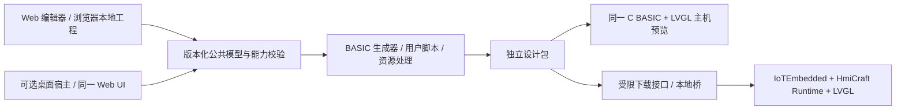

# lvgl-editor 在线版与 PR 整合分析

核查日期：2026-10-10。用户要求评估在线版，整合 `IoTSharp/lvgl-editor` 和两个开放 PR。本轮先接入固定 main，完成关键源码/差异复核；没有向上游发送消息、合并 PR，也没有将 LispBM 替换为既定 BASIC。

## 固定基线与实际接入

| 对象 | 固定提交 | 事实 |
|---|---|---|
| 上游 main | `0d0d62f655442dd5624a00390b7652222a7b3fc8` | 2026-03-30，已作为 `external/LvglEditor` Git 子模块接入 HmiCraft |
| PR #2 | `d8a0efe19eddcb58b4c4b7bd6a7ad65361862754` | 草稿，5 个提交、13 个变更文件；OmniHost 桌面外壳 |
| PR #3 | `3647ce025bc65cd14c968c1d329dc40d593f7e51` | 非草稿，58 个提交、341 个变更文件；LispBM/VESC 专用方向的大幅修改 |

两个 PR 均基于上述 main。GitHub 当次返回 mergeable=true 只表示当时可做 Git 合并，不代表产品方向、许可、构建或行为通过。PR 状态是时间快照，采纳前应再次核对 head SHA。

私有仓库的初始接入仅固定 main 源码。完整 PR 历史头在根 `analysis/work/lvgl-editor-baseline` 只读复核，不进入父仓；父仓中的子模块不包含未提交修改。

## 可复用能力和差异

| 领域 | 已读源码 | 整合判断 |
|---|---|---|
| Web 工作台 | React/TypeScript、Zustand、Monaco、React Flow、页面与属性/事件 UI | 优先复用现有 Web 编辑能力，避免重新开发全部画布；不据 README 宣称生产就认定稳定 |
| 工程模型 | `src/types/index.ts` 包含稳定 ID、嵌套控件、样式状态、事件、动画；`projectStore.ts` 用 IndexedDB | 与当前 C# JSON 不是同一格式，需版本化公共模型与显式映射，不做直接字段拼接 |
| 逻辑图 | 触发/条件/动作/数据节点、执行/数据连接、自定义 `c_code_block` | 基础节点可映射 BASIC 事件；C 代码块不自动转 BASIC，保留并诊断未支持能力 |
| 资源 | Base64 图片/字体、像素格式、字形范围、C 数组名称 | 可复用资源编辑概念，发布时转换为 HmiCraft 资源索引/文件；不直接把全部 Base64 JSON 放 MCU |
| 生成器 | 生成 `ui.c`、事件/逻辑 C 与头文件；配置可选 LVGL 8/9 | C 后端可保留研究和互操作，HmiCraft 主线新增 BASIC 后端；包/能力/version/source map 应统一 |
| LVGL 版本 | README 仍描述 v8 限制，但 projectStore 与 codegen 默认 v9 | 文档漂移，不能按 README 选设备 ABI；实际生成代码还需编译验证 |
| 预览 | Canvas、预编译 WebAssembly 与服务端 C 编译入口并存 | 视觉预览不等于同一 BASIC runtime；三类证据分开，未来对齐同包和事件轨迹 |
| 编译服务 | Vite 插件有 `/api/compile` 与固定 Linux Emscripten 路径 | 开发辅助代码不能直接当公网服务；首个静态 Web 构建关闭此功能，服务化另定隔离/资源/访问合同 |
| 测试 | 存在 Vitest 测试目录，与 README“尚无测试”说法不符 | 以实际 runner 为准；C 编译集成测试硬编码其他机器 `/home/xcssa/...` 路径，本机未具备其环境 |

关键来源均在固定子模块：[工程模型](../../external/LvglEditor/src/types/index.ts)、[工程存储](../../external/LvglEditor/src/store/projectStore.ts)、[逻辑图](../../external/LvglEditor/src/components/LogicEditor/types.ts)、[生成器](../../external/LvglEditor/src/codegen/generator.ts)、[资源](../../external/LvglEditor/src/resources/types.ts)、[Vite 配置](../../external/LvglEditor/vite.config.ts)、[编译服务](../../external/LvglEditor/vite-plugin-compile.ts)。

## 两个 PR 的采纳方式

### PR #2：桌面外壳，独立后置

PR 地址：`https://github.com/IoTSharp/lvgl-editor/pull/2`。采用 .NET 8 的 OmniHost，新增菜单和桌面打包。实际路径为 `desktop/Program.cs`、`desktop/LvglEditor.Desktop.csproj`，不是 PR 文字描述中的另一层目录。

关键缺口：macOS 路径直接抛 `PlatformNotSupportedException`；项目静态资源 `../../dist` 相对于 `desktop/` 的路径需要构建核对；依赖私有包源凭据；未配置凭据时 workflow 会成功跳过，不代表产物可运行。当前 HmiCraft 为 .NET 10，若采用还需目标框架和平台依赖决策。

建议把菜单接线和本地宿主作为独立选择性任务；先证明窗口、资源路径、文件访问和设备桥，再谈三平台发布。不能整体采纳草稿后宣称桌面跨平台完成。本轮未安装 OmniHost 包或执行该 PR。

### PR #3：提取通用改进，保留独立目标后端

PR 地址：`https://github.com/IoTSharp/lvgl-editor/pull/3`。它把生成器改为 LispBM，目标为外部 VESC Express P4 Dashboard 项目；还改动主题、双语 UI、画布结构、资源转换和 WASM，并删除原 C 生成器、许多文档和原生成器测试。

建议分成三组处理：

1. **待逐项采纳的通用改进**：画布交互、状态拆分、资源编辑、主题/本地化基础，先明确修复对象与回归语料。
2. **可选目标插件**：LispBM/VESC 生成与资源格式。如果以后需要，保留独立后端和对应测试，不能替换 BASIC/IoTEmbedded。
3. **不作为 HmiCraft 默认的变更**：覆盖公共品牌、取消中文默认、整体删除原文档/C 后端测试、将普通打包绕开 TypeScript 检查。保留可追溯材料，再按最终产品决定迁移。

PR README 自述推荐 `build:web` 绕过现有 TypeScript 问题；这不是完整构建通过证据。本轮为关键结构/目标差异复核，尚未逐行审计 341 文件，也未执行 PR #3 的 tests/build。

## 在线版定位建议

建议以 **Web 为主要编辑入口，桌面/本地桥作为离线与设备访问补充**。复用一套 UI 和工程合同，不同时重写两套完整画布；保留 .NET 在公共模型、校验、资源/包工具、网关和本地集成中的价值。原 Avalonia 切片保留，不在路线调整时删除现有工程读取能力。

在线版不等于强制云端保存或持续联网。第一阶段用静态站点加浏览器本地工程存储/导入导出；协作、账户、云存储、服务器编译和设备运维是独立能力。现有 IndexedDB 存储也不等于已完成离线安装/缓存，需要单独验证断网启动、资源和工程恢复。

不能默认网页可以无条件访问所有串口/USB/网络设备。LVE-07 用实际目标浏览器和设备验证权限/传输，并在需要时提供有限权限的本地桥；不把普通网页访问转为任意本地命令执行。

共同运行链路为：Web 或桌面工程 → 校验后的公共模型 → BASIC/资源包 → 同一设备 runtime。图形/事件/资源固定向量同时验证前端、编译器、主机模拟和设备；C# 与 TypeScript 不要求互相嵌入同一程序集。

本图是目标架构。现有 C# JSON 与上游 Web JSON 尚未互通，当前 Web WASM 预览不是图中的同一 BASIC runtime。

### 实施批次与取舍

| 批次 | 交付 | 完成依据 |
|---|---|---|
| W0 / LVE-08 | 清理固定 main 的类型和字体回归，参数化 C 编译测试环境 | 保留初始失败；类型检查、单元测试、目标 C 编译各有独立结果；类型检查不能从正式 build 中删除 |
| W1 / LVE-04 | 浏览器新建、编辑、本地保存、导入导出；随后离线缓存与恢复 | 浏览器旅程及关页/断网/数据恢复证据；IndexedDB 不是备份，明确工程导出/恢复入口 |
| W2 / LVE-05 | 公共模型、生成 BASIC、资源包和诊断映射 | 六基础控件先行；未知控件/旧 C 节点明确拒绝或保留，不静默丢失；版本和固定语料一致 |
| W3 / LVE-06/07 | 同 BASIC/LVGL 预览、目标板包下载及回读 | 区分浏览器画布、主机 runtime 和实板；日常包更新不改变基础固件 SHA |
| 可并行评估 / LVE-09 | PR #3 的画布/资源/状态/i18n 改进 | 按依赖拆补丁，每项有明确收益、测试、来源及回退提交；不能只挑一段代码遗漏依赖 |
| 按需后置 / LVE-10 | PR #2 的菜单和桌面宿主 | 菜单与宿主分别验收；Windows 先闭环，Linux/macOS 各自验收，不能沿用成功跳过的 CI |

PR 采纳台账需记录来源 PR/head、涉及文件、依赖补丁、保留/替换行为、许可来源、前后验证与采纳提交。当前只有关键结构评估和固定 main 接入，没有产生任何 PR 采纳提交。下一次实施先解决 W0，再选择确有收益的通用补丁；不以“两个 PR 全合并”作为验收目标。

## 许可、构建与证据边界

固定 main 的 README 声明 MIT，但 GitHub license 元数据为 null，完整 Git 树未找到 LICENSE/LICENCE/COPYING/NOTICE 文件。不能仅凭 README 徽章对整仓和所有资源做 MIT 分发声明。已纳入 LVE-02/GOV-04；本次仅接入私有集成仓库的固定依赖，未添加许可或公开发布。

Node/npm 依赖安装采用固定 lockfile，`npm ci --ignore-scripts --no-audit --no-fund`；没有执行项目安装脚本。测试关闭远程 C 编译预览，并将依赖固定 Emscripten 机器路径的 `compile.test.ts` 单独列为未运行，其他测试与 TypeScript/build 分别记录。没有扫描或安装未知编译器。

实际结果：`tsc -b` 退出 2，既有问题包含 `GeneratedCode` 类型契约、缺少 `LvglComponent` 导入、新工程缺 `useBuiltinSymbols` 和未使用声明。Vitest 已执行 11 个文件、390 项，386 项通过、4 项字体相关断言失败；这些差异需要先确认字体契约，不能只改断言让测试通过。关闭编译预览的 Vite 静态 bundle 退出 0，仅证明转译和打包成功。

回执名称在 `artifacts/process/`：`lvgl-editor-*` 是源码/PR 快照，`hmicraft-lvgl-submodule-*` 是接入，`hmicraft-web-*` 是实际 Web 检查。本轮结果见 [仓库和在线基线验证](../verification-hmicraft-bootstrap-2026-10-10.md)。没有浏览器 GUI、设备或上游 PR 通过声明。
