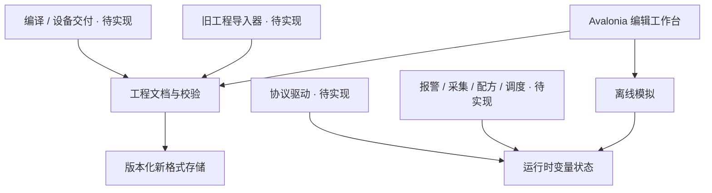

# 架构与实现范围

项目现名 **HmiCraft · 可编程人机界面平台**。用户新增在线版整合方向，固定接入 `external/LvglEditor`；Web 主入口及可选桌面/本地桥见 [ADR 0003](adr/0003-web-and-product-governance.md)。下文 HmiStudio 是现有技术标识，现有桌面切片保留，不代表后续仍需另建完整重复画布。

2026-10-10 用户明确新增设备主线：VB6 式设计器生成 BASIC 创建/布局代码和资源包，基于 IoTEmbedded + LVGL 的设备独立运行；固件中的控件库稳定，用户后续更新资源与 BASIC。下文“当前”仍指已实现的桌面切片，不能当作设备运行时已完成。

完整分层、库归属、包/API合同、持续事件、GPIO/传感器/协议和更新恢复见 [设备执行层](design/embedded-runtime.md)；硬件依据见 [选型草案](design/hardware-selection.md)。新设备闭环优先，旧 外部样本 格式/宏/原屏是独立后置兼容线。

| 项目/层 | 实现语言与职责 | 状态 |
|---|---|---|
| HmiCraft Web 设计器 | TypeScript/React，复用 lvgl-editor 的画布/属性/资源；接公共模型、BASIC生成与部署 | 固定子模块已接入；类型/测试缺口待修，BASIC链路未接通 |
| HmiStudio 桌面切片/本地工具 | C# / Avalonia现有离线编辑；后续 .NET 校验/资源/包/网关与本地桥按合同分工 | 编辑切片已实现；与Web的版本化模型映射待实现，避免重做完整画布 |
| HmiStudio 设备 runtime | C，LVGL 控件库/port、BASIC HMI API、包、资源、事件、变量与 IO 绑定 | 已规划，未实现 |
| IoTEmbedded | C，平台/BSP/RTOS、通用驱动/协议、BASIC 内核、存储 | 已引入固定子模块；按能力基线补齐，未做本项目硬件验证 |
| OPC UA 网关 | 独立网关或按需 .NET 服务，转换到 Modbus/TCP | 已确定首版路径，未实现/验收 |

设备端不运行 Avalonia；跨语言共享格式/API合同和固定向量，不能把 C# Core 当作直接运行在 MCU 的二进制。原有 C# 离线模拟与后续“同一 C runtime + LVGL”的主机预览分别记录一致性证据。

## 现有桌面切片分层

当前 Core 和 Desktop 两个程序集足以交付首个切片。图中的后续边界先作为设计约束，未创建空服务或伪实现。模拟状态与文档初始值隔离；桌面 UI 不能直接访问 USB、串口或固件地址。

## 文档模型

`HmiProject` 有版本、名称、画面和变量；`HmiScreen` 有稳定 ID、逻辑像素尺寸、背景及控件；`HmiWidget` 有稳定 ID、种类、矩形几何、文字、颜色与可选变量绑定。六类首批控件为矩形、椭圆、文本、开关按钮、指示灯、数值显示。

新格式是 UTF-8 JSON，扩展名 `.hmistudio.json`，当前 schema 为 1。Boolean 使用 0/1；Number 为有限 double。这是原型语义，**不是**旧 HMI 的 LB/LW/RWI、16/32 位、BCD、字节序或动态地址规范。正式地址模型须单独扩展，不能把当前 double 运行时直接当 PLC 内存。

源生成序列化要求稳定 ID、版本和必需集合，拒绝未知字段和未来版本。单文件不超过 16 MiB，总控件不超过 20,000。保存先写同目录独占临时文件，再替换目标；取消或序列化/校验失败不能覆盖旧文件。失败回滚验证不等于断电可靠性证明，跨文件系统与断电测试在独立门禁。

## 编辑与模拟

界面当前编辑第一个画面，其他画面数据保留。撤销/重做保存完整文档快照，上限 100；这是小工程优先的选择。大型工程需测量后改命令历史和增量模型，不能承诺 20,000 控件画布性能。

拖动直接更新画布几何，在正常释放、捕获丢失或窗口失焦时收束为一条历史。属性编辑先校验，不接受越界几何、不兼容变量类型和非法颜色。文件操作期间禁用编辑及工程切换，窗口关闭也受保护，防止异步保存/读取覆盖较新的状态。

`OfflineSimulator` 从文档生成独立值表，支持 Boolean 切换、Number 写入和 Reset。当前无计时器、通信、宏或自动设备行为；不会伪造真实采样值。按钮只实现切换语义，点动/置位/复位、多态与事件顺序另有路线。

## 后续边界

1. **LegacyImport**：读取样本，生成文档与诊断；未知控件、字段和资源单独保留。先只读导入，直到往返与原程序验收通过再讨论写旧格式。
2. **地址与调度**：明确位/字/双字、端序、符号与 BCD、动态地址、质量状态、只读限制；通信超时后标记失效，不能把旧值当新采样。
3. **业务运行时**：报警、采集、历史、配方共用地址与事件总线；用确定性时钟验证边沿、重入和恢复。
4. **MacroCompatibility**：原头文件、C89 限制与型号 ABI 分开建模；导入原文、编译、模拟执行、设备执行分别验收。不能声称换成 C# 脚本就兼容旧宏。
5. **Transport/DeviceDelivery**：新的设备通用传输/Modbus 驱动归 IoTEmbedded，本仓负责工程变量/IO 绑定、包更新和部署；OPC UA 首版经网关。旧屏协议仍独立调查，旧 x86 DLL 仅为分析对象，不进入新的 MCU runtime。
6. **平台发行**：Linux/macOS 不依赖 Windows 注册表、盘符、x86 DLL 或 CHM 运行时；资源与字体需重新制作或取得许可。原厂图库不成为新产品默认素材。

## 当前实现取舍

首版桌面采用 code-behind 接线，便于验证实际交互，未把少量功能拆成大量抽象。多画面、图层、选择集和命令系统形成后，再按可测行为提取 ViewModel/编辑会话。每次改造必须保留既有工程读写和离线模拟旅程。
