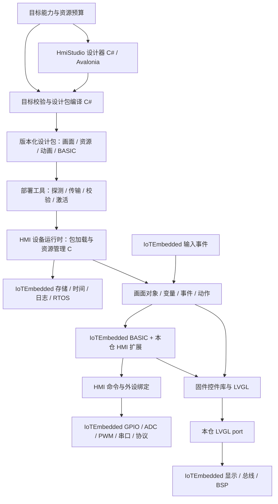

# 设计器、HMI 设备运行时与 IoTEmbedded 的职责

日期：2026-10-10。状态：核心产品路径已由用户逐项确认；硬件选型、接口数量和性能预算仍属待实测的设计建议。没有把计划写成现有固件能力。

## 已确认的产品闭环

HmiStudio 是工程设计器；设计结果要在 STM32 或同类 MCU 控制的屏幕上独立运行，LVGL 承担设备端 UI。基础框架使用 IoTEmbedded，以本仓 Git 子模块维护；必要的通用框架改进回到该子项目。

用户已明确偏向独立设计包：LVGL、触摸/控件实现及硬件驱动编入基础固件，后续主要下载动画、图片/字体等资源和 BASIC 业务脚本。不是在 MCU 上运行 Avalonia/.NET，也不是把每次画面修改都变成重新编译基础固件。

同时需要 ADC/PWM、串口/RS485 等外设联动。首款按工业 HMI 研究：4.3～7 寸、24V、触摸和 RS485，监视 GPIO、温度、位置/计数、开关及模拟量等状态；高速计数交给硬件，BASIC 负责事件，不承担轴运动闭环。协议需要 Modbus、TCP/串口扩展；OPC UA 首版通过网关转换为 Modbus/TCP，屏端暂不运行 OPC UA 栈。当前没有指定实物，硬件需要按需求、整机成本和性能从公开资料选型。现有 800×480 桌面示例不自动成为设备分辨率合同。

设计器交互采用用户确认的 VB6 式工作方式：工程/窗体或页面/控件树、拖放布局、属性窗口、控件事件和代码编辑、运行/停止与诊断。编辑器保存结构化设计模型，发布时由生成器输出 BASIC 创建代码；不要求用户手写每个控件创建过程。具体语言以 IoTEmbedded 的 BASIC 能力和本仓 API 为准，VB6 类比用于设计工作流，不作 VB6 二进制/COM 或全部语法兼容承诺。

新的“设计器→设备运行”闭环为第一主线；旧 外部样本 工程导入、旧 C 宏和旧屏下装独立后置，不成为新设备运行时的前置依赖。

基础固件稳定不等于永远不升级：新增原生控件、驱动、解码器、脚本 API 或修复固件缺陷仍需要固件更新。普通布局/资源/已有动作变化应只更新设计包；设备在下载前报告支持的版本与能力。

## 运行与构建边界



图中设备部分目前均为计划。IoTEmbedded 的事实基线和具体缺口见 [能力分析](../analysis/iotembedded-baseline.md)。

## 项目分工

| 内容 | 主归属 | 另一边的责任/接口 |
|---|---|---|
| MCU/板卡启动、HAL、RTOS port、时钟、中断、看门狗、总线 | IoTEmbedded | HmiStudio 选择目标 profile，提供产品任务组合 |
| 显示控制器驱动、像素区域传输、DMA/缓存、背光底层 | IoTEmbedded | HmiStudio 的 LVGL port 负责适配 LVGL 的 flush/tick/完成回调 |
| LVGL 依赖版本、控件封装、主题、对象生命周期、页面导航 | HmiStudio 设备运行时 | IoTEmbedded 不包含项目画面/控件 ID，不依赖 HmiStudio |
| 触摸采样/校准底层、按键电平/消抖、编码器采集 | IoTEmbedded | HmiStudio 定义焦点、导航、短/长按动作绑定、页面作用域和触摸映射 |
| GPIO/ADC/PWM/UART/RS485 等可复用硬件服务 | IoTEmbedded | HmiStudio 定义逻辑通道、变量绑定、事件动作与命令反馈 |
| Modbus/MQTT 等通用协议栈 | IoTEmbedded | HmiStudio 定义变量轮询表、转换、质量状态和画面绑定；不再造设备端协议栈 |
| OPC UA→Modbus/TCP 网关及映射配置 | HmiStudio 集成层或独立既有网关 | 首版不放进 MCU/IoTEmbedded；本项目拥有映射和端到端验收，可复用现成网关 |
| BASIC 解释器、通用函数、执行预算/取消/让出机制 | IoTEmbedded | HmiStudio 注册 HMI 函数、路由事件、管理与工程关联的脚本 |
| Flash/文件/分区、块读写、传输和原子元数据机制 | IoTEmbedded | HmiStudio 解释设计包格式，校验目标能力，组织激活和失败恢复 |
| 设计包 schema/ABI、控件/资源/脚本索引、编译器 | HmiStudio | IoTEmbedded 不识别 `.hmistudio.json` 或 `.hmipkg` |
| 固件 bootloader/升级底层与通用恢复钩子 | IoTEmbedded | HmiStudio 部署工具分清固件升级和设计包更新，展示准确状态 |
| 设计器、导入器、资源工具、目标编译、部署 UI | HmiStudio | 消费框架/板卡能力，禁止直接用 Windows 驱动作为 MCU 实现 |
| HMI 报警、配方、历史、页面权限和业务状态 | HmiStudio | 可复用底层持久化/时钟/协议；是否在目标固件启用由 profile 决定 |
| 通用开发板驱动修复/资源表 | IoTEmbedded | HmiStudio 提交最小复现与硬件验收，不复制一份永久私有驱动 |
| 通用主机 port、可注入时钟/存储/外设接口 | IoTEmbedded | HmiStudio 拥有预览窗口、LVGL 主机显示/输入适配和工程语料；共享同一 BASIC 内核 |
| 产品布局、IO 逻辑命名、产品引脚绑定、分区组合、固件入口 | HmiStudio 产品集成 | 底层板级电气映射和可复用 BSP 仍由 IoTEmbedded 维护 |

判断一个改动放哪里：不认识任何 HMI 工程也能复用的硬件/解释器/平台能力进入 IoTEmbedded；涉及设计包、控件、页面、变量绑定、工程动作、HMI 产品验收的内容留在本仓。上游现有 `Application/Devices/Protocol/Platform` 带有示例或既有产品行为，并不意味着新 HMI 也要接入该业务。

项目角色分工：设计器维护者负责工程/编译器；HMI runtime 维护者负责包、控件、事件和脚本扩展；IoTEmbedded 维护者负责通用接口与驱动；板卡集成维护者负责接线、profile 和固件组合；验证维护者维护共同语料与设备回执。一人可承担多个角色，但每个接口和路线任务只有一个主归属。跨仓任务必须列出两个交付 ID、固定提交和各自验证。

## 目录和依赖治理

```text
external/IoTEmbedded/        已引入，固定 gitlink；通用框架的唯一源码位置
src/HmiStudio.Core/          已有：可编辑工程及校验
src/HmiStudio.Desktop/       已有：跨平台设计器
src/HmiStudio.Compiler/      计划：目标校验、资源处理和设计包生成
src/HmiStudio.Deployment/    计划：设备能力探测、包传输与状态
src/HmiStudio.Gateway/       按需：自建网关时的 .NET 服务；选现成网关则只保留配置与合同
contracts/hmi/              计划：包/API/profile 版本、错误码、共同固定向量
firmware/runtime/           计划：纯 C，每模块 Inc/ 与 Src/
  Package/ Scene/ Tags/ Events/ Actions/ Resources/
  Lvgl/ Bindings/Basic/ Ports/IoTEmbedded/
firmware/products/<target>/  计划：本产品入口、任务、逻辑 IO、分区、lv_conf
firmware/host/               计划：同一 C runtime + LVGL 的主机验证入口
tests/fixtures/hmi/          计划：新包固定语料与 C#/C 交叉验证
```

只创建实际需要的文件，不预填空实现。本轮不把设备 C 源码塞入 .NET 解决方案。

- `external/IoTEmbedded` 的修改、测试和提交属于独立 Git 仓；父仓只记录更新后的 gitlink。
- 通用修改先在子模块内建立明确分支/提交并完成上游门禁，再更新父仓固定提交；不将未提交脏子模块称为可复现依赖。
- 父仓提交之前，子模块提交应能从约定远端获取；本地 commit、push/PR 和发布分别记录。本轮没有提交、push 或远端 PR。
- 不使用 `git submodule update --remote` 自动追新，不从本仓反向污染上游默认应用；依赖只单向流动。
- LVGL 当前未加入。设备切片启动前选定一个受目标 BSP 支持的版本，由 HmiStudio 固件构建统一锁定一份；若 ESP-IDF/BSP 已管理 LVGL，则统一该依赖，不再静态链接第二份。固件维护者拥有 `lv_conf` 和 renderer ABI。
- .NET、VisualGDB/CubeMX、未来 ESP-IDF/主机 C 构建各有明确入口；编译辅助工具优先 C#，不为未知工具链扫描磁盘。

## 固件、设计包与运行状态分开

### 基础固件

包含 IoTEmbedded 所选模块、LVGL、HMI runtime、原生控件和脚本绑定、硬件 profile、解码器和部署服务。可拆成编译期静态库，最终链接成目标固件；用户下载设计包时不下发任意动态链接库，也不假设 MCU 有桌面操作系统的 DLL loader。

### 设计包

暂用 `.hmipkg` 作为讨论名，尚未冻结二进制布局。编辑格式 `.hmistudio.json` 保持独立；不能把桌面 JSON 不经预算/校验直接交给低资源 MCU 解析。

用户已选择 **布局也生成 BASIC**。包至少包含 manifest、生成的 UI BASIC、用户事件/业务 BASIC、资源索引、字形/图片/动画资源、变量与外设绑定、入口和校验信息。固件运行生成代码，调用封装库创建 LVGL 对象，再进入持续事件循环。无需额外强制引入一套与 BASIC 并行的二进制场景解释器；资源和绑定表仍可采用紧凑数据表示。

生成文件（例如 `ui.generated.bas`）与用户文件（例如 `events.bas`、业务模块）分开管理；名称只是建议。生成器拥有创建/布局/属性初始化与稳定 ID 映射，用户拥有事件函数内容。拖动、改属性、控件重命名或重新发布不得覆盖用户代码；删除被事件引用的控件须产生诊断。保存工程、生成代码、打包和设备执行是四个独立步骤。

必须保存 source map：生成代码行号关联工程/页面/控件 ID，用户脚本错误关联文件/行号；设备错误能回到设计器中的对应控件或事件。可视设计模型是布局编辑源，手工修改生成文件不自动回写画布；需要手写动态控件时进入显式用户模块并声明由脚本拥有。

必须区分以下版本：编辑 schema、包 format、runtime ABI、控件/脚本 API、板卡 profile、固件 build、IoTEmbedded git SHA、LVGL 版本/配置。包声明所需能力与预算，设备报告实际能力；版本或必需能力不满足时在激活前拒绝并给出原因。

manifest 规划字段：包 ID/版本、目标 profile 或能力约束、逻辑分辨率/色彩要求、最小 runtime/API、各段长度与摘要、对象/变量/脚本/资源预算、入口页面、脚本依赖、保留变量迁移规则。精确字段宽度、字节序、对齐和压缩算法在格式 ADR 中冻结；压缩不等于可容忍无限解压尺寸。

### 运行状态

变量的当前值、质量/时间戳、输入按下状态、异步外设命令、报警/配方状态不能反写设计包。仅选定的保留变量持久化；包升级时显式迁移或重置，不能因同名变量类型变化而复用旧字节。

## BASIC 与控件封装

复用 IoTEmbedded 的 MY-BASIC。基础动作可直接配置，生成器将其转为等价的受检事件调用；复杂逻辑由用户 BASIC 实现。生成的布局脚本和用户脚本均调用本仓定义的稳定 HMI API，由固件控件库执行；不公开 `lv_obj_t*`、MCU 地址或 HAL 句柄。按钮等控件以稳定 ID/受检句柄访问，重载包后旧句柄失效。

API 族提案：页面切换、对象属性、变量读写、定时器、动画启停、逻辑 IO 操作、订阅结果、诊断。具体名称和参数尚未实现，必须用固定语料同时验证编译器、主机 runtime 和设备。IoTEmbedded 的通用函数表可复用，本仓另注册 HMI 函数，不能把项目依赖写入其 registry。

用户已确认需要持续事件循环，响应定时器和变量变化，并能操作界面及外设。事件包括页面进入/退出、点击/按下/释放、实体按键、编码器增量、变量改变、定时器和外设完成。明确定义事件参数、顺序、合并/丢弃规则、重入及队列上限。脚本执行要有指令/墙钟/堆/字符串预算，并可取消或让出；仅有看门狗不能替代脚本调度合同。长期运行由宿主持久调度事件实现，不要求用户用无限循环占用 UI 线程；主机验证循环仍有独立次数和墙钟上限。

UI 任务独占普通 LVGL 调用；工作任务和脚本通过有界命令队列更新 UI。通信超时或脚本循环不能阻塞刷屏。LVGL port 按冻结版本的规则处理 tick、flush complete、DMA 生命周期和线程互斥。动画由引擎按时间推进，不要求 BASIC 高频逐帧重绘。

原 外部样本 的 C 宏仍是独立兼容研究，不因新增 BASIC 运行时自动兼容。当前 BASIC 的旧 `SCREEN/PSET/LINE` 直绘路径在 HMI profile 中应禁用、重定向或明确为独占模式，不能和 LVGL 抢屏。

## 外设控制与输入事件

触摸按钮和实体按钮都可以触发同一个逻辑 action。按键原始电平、触摸坐标和编码器计数由 IoTEmbedded 获取；HMI 定义焦点组、页面作用域、点击/长按/连发/点动与释放行为。应保证一次操作不会同时被 LVGL 导航和业务绑定重复消费。

逻辑资源使用诸如 `panel.key1`、`process.temperature1`、`output.pwm1`、`bus.rs485_1` 的 ID；产品 profile 将其映射到驱动/引脚。设计器绑定逻辑资源，不写死 GPIOA 地址。ADC/PWM/串口属于已要求的范围，通道数、电气范围、采样率、精度和负载尚待确定。

ADC 合同应含原始码/工程单位、量程、校准、更新时间和故障质量。PWM 合同含频率、占空比、定时器共享冲突、更新方式和可配置恢复值。串口/RS485 合同含波特率/校验/方向控制、超时、取消和完整帧。模拟量 0～10V 或 4～20mA 必须经匹配的板级前端，不能把 MCU ADC 引脚能力等同工业采集通道。

显示值、期望输出、驱动已接受、操作已完成、实际反馈是不同状态。写入失败不能显示为设备已执行；读取过期保留质量标记。点动输出在丢失释放、切页、脚本失败、包更新和设备重启时按预先配置的行为收束；具体输出值由产品定义，不能对所有外设一律设为零。

## 协议与 OPC UA 网关

首版设备作为 Modbus RTU/TCP 主站/客户端采集外部设备，按配置执行受控写入；对外提供 Modbus server 是独立能力，不能把主站支持泛化为双角色。现有 IoTEmbedded Modbus 路线主要是 RTU；本轮在 Protocol、Interpreter、docs/basic 中未发现 Modbus TCP/MBAP 的入口，TCP client 需单独实现和验收。

用户已选择通过网关转换 OPC UA：网关作为 OPC UA 客户端订阅/读取实际服务器，将值映射到 Modbus/TCP；HMI 设备通过 Modbus/TCP 读取。映射必须规定类型、寄存器顺序/字节序、浮点/64 位、质量、时间戳、更新频率和错误码。OPC UA 的节点模型、方法和事件不能无损等同几个寄存器；首版限定为已声明的变量映射。

若配置反向写入，要有写命令序号、接受/完成/失败状态及实际反馈，不能把 Modbus 请求已响应当作 OPC UA 写入成功。网关掉线、值过期、断网重连须使屏端呈现质量状态。OPC UA 证书、会话、安全策略由网关维护；不能为适配 MCU 而静默关闭服务器的安全要求。

网关可先使用用户现场已有软件/设备；若没有可用网关，再在本仓集成独立 .NET 网关，进程部署在工业 PC/Linux 主机上。网关实现不写进 IoTEmbedded；MCU native OPC UA 是后续独立 profile，当前没有这项首版承诺。

自定义 TCP/串口采用可注册驱动：每个驱动固定帧边界、编码、校验、超时、最大消息、断包/粘包处理、重试和取消。不能将“有 socket/UART”视作自动兼容所有设备。温度、编码器、位置和模拟量设备逐个用明确型号/协议或直接 IO profile 接入。

## 存储、下载和恢复

设备包读取采取流式/按需资源加载，按 profile 使用内部 Flash、外部 NOR/PSRAM/SD 等资源。现有 EEPROM 4 KiB BASIC 槽不用于整包存储。可借鉴其生命周期，不能直接声称已有 HMI 包 A/B 恢复。

包更新规划为：能力协商 → 传输候选包 → 完整性/格式/资源预算校验 → 有序停止旧脚本与相关动作 → 切换候选 → 画面/脚本启动验证 → 确认激活；失败维持或恢复上次有效包。资源、布局和脚本以一个代际提交，禁止混用新脚本与旧资源。是否无需设备重启、双分区大小、首个传输媒介、签名要求随目标冻结；普通更新首版可在停止运行后激活，不先承诺无缝热切换。

CRC/摘要用于损坏检测；若要求验证包来源，另定义签名和密钥接口，不能把 CRC 当签名。网络 OTA、USB/串口包传输和固件烧录各自验收。设计包更新不得隐式覆盖 bootloader/基础固件。

## 资源预算和模拟一致性

目标 profile 至少包含 Flash/RAM/外部内存、屏幕尺寸/像素格式/传输模式、输入/IO、可用控件/脚本 API/解码器及包和运行预算。桌面编辑上限 20,000 控件不是设备承诺。

例如 RGB565 单帧仅像素就需要 `width × height × 2` 字节：240×240 为 115,200 字节，800×480 为 768,000 字节；双缓冲翻倍。还要分别计算 LVGL 对象/绘制缓冲、BASIC AST/变量堆、中文字体/图片解码缓存、RTOS 栈和协议缓冲。分块绘制可降低某些缓冲占用，但 RGB 扫屏、传输带宽和资源解码需求必须单独核验。

现有 C# 离线模拟继续服务编辑体验；之后增加同一设备 C runtime + 相同 LVGL/字体/资源转换的主机预览。主机预览验证布局/事件/包语义，仍不能替代 STM32/其他 MCU 的内存、DMA、触摸、IO 时序和断电验证。跨语言共用合同与固定向量，不声称 C# 与 C 自动共享同一份可执行实现。

该预览还依赖 IoTEmbedded 的通用主机 port（IEB-11）：将时钟、存储和外设服务变为可注入依赖，选择同一 BASIC 内核和通用模块，Windows 先行，避免依赖 STM32 HAL。HmiStudio 提供 LVGL 的主机显示/输入适配及预览入口。模拟 IO 明确标识；主机事件语料可先于板卡 port 验证，但不能将模拟驱动成功当作板卡支持。

## 决策清单

“理解到 98%”以关键问题关闭和验收可写为标准，不凭主观数字宣称达标。

| 项目 | 当前状态 |
|---|---|
| 桌面是设计器，设备自主运行；设备 UI 用 LVGL | 用户已确认 |
| IoTEmbedded 作为基础框架，Git 子模块，可按需改进 | 用户已确认；本地子模块已接入 |
| 基础固件内置控件库，日常更新资源与 BASIC 脚本 | 用户已确认 |
| ADC/PWM、串口/RS485 等联动 | 用户已确认范围；具体通道和电气要求待定 |
| 首个硬件 | 用户授权联网选型；主选 ESP32-P4 工业屏架构、STM32H7 备选属于工程建议，见硬件草案，尚未采购或实测 |
| 设备尺寸/供电 | 用户确认工业 HMI、4.3～7 寸、24V、触摸、RS485；接口数量、防护等级、批量和成本上限未指定 |
| 布局表达 | 用户已确认生成 BASIC 调用固件控件库；不再把独立场景描述解释器作为首版默认 |
| 设计器工作方式 | 用户明确类比 VB6；规划属性/事件/代码/运行调试，生成代码与用户代码分离 |
| 新设备与旧 外部样本 兼容优先级 | 用户已确认新设备闭环优先，旧工程/C 宏/旧屏下装独立后置 |
| 传感器和实时性 | 用户确认监视采集，高速计数交给硬件，BASIC 处理事件，不承担轴闭环 |
| OPC UA | 用户确认网关转 Modbus/TCP，首版 MCU 不直接运行 OPC UA |
| 脚本调度 | 用户确认持续事件循环，定时器/变量变化/界面/外设；必须有预算且不阻塞 UI |
| 下载首选媒介、无需重启要求、资源规模/动画等级 | 工程建议以有线网络为主要包传输、USB/串口为调试/恢复；首版停止运行后激活，可重启；资源/性能阈值待首板测定，不作为用户已批准的数值 |

先完成有证据的边界、能力缺口和候选设计。未关闭项保持待决策，不因此阻塞独立的源码分析和文档工作，也不提前实现依赖这些答案的具体固件。
